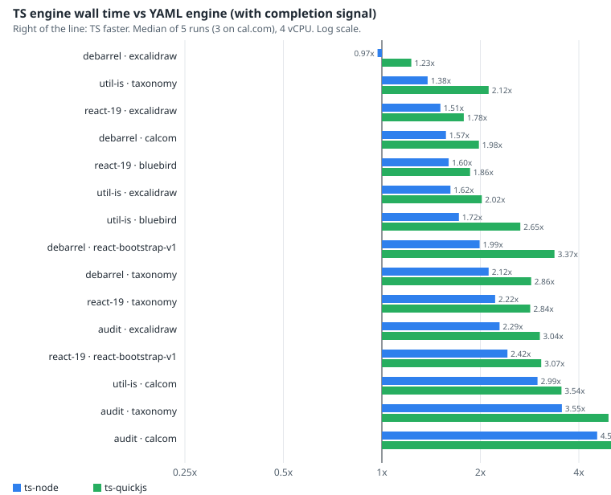

# TypeScript orchestration vs the YAML engine: simplicity and performance

Prepared Nov 8, 2026 and updated Nov 9 for the decision to replace the YAML workflow engine (butterflow, `codemod/codemod` `main`) with the TypeScript orchestration prototype (`prototype/typescript-orchestration`, draft PR #2411).

> **Nov 9 update: the `node` runtime is removed.** `quickjs` is now the only runtime (local commit `a3823d9a` on `local/ts-orch-quickjs-only`, not pushed). The `ts-node` numbers below are kept as history. A same-machine A/B against the pool build shows no regression (medians of 5 runs, `perf-pool/quickjs-only-ab.csv`): react-19 on excalidraw 7.35 s vs 7.49 s, 108 MB vs 106 MB; debarrel on cal.com 17.7 s vs 18.0 s, 319 MB both; diffs byte-identical.

## Verdict

Updated Nov 9 with the transform worker pool (M13) and per-file error skipping (M14), built locally on top of the branch.

TS now beats the YAML engine on every non-trivial workload, including the CPU-heavy migrations it lost on Nov 8. With 4 transform workers, react-19 on excalidraw takes 7.1 s on `ts-quickjs` and 8.4 s on `ts-node`, against 12.7 s for YAML (it was 23.7 s). debarrel on cal.com takes 17.0 s and 21.4 s against 33.5 s (it was 70.0 s). The audit pack on cal.com is now 6.0x faster than YAML (13.2 s vs 78.8 s). Every run still produced byte-identical diffs and the same audit findings, and TS still uses 1.3–5.6x less CPU. The one cell where TS does not win is debarrel on excalidraw with the `node` runtime: 9.7 s vs 9.4 s, a tie.

`ts-quickjs` is now the fastest arm in every non-trivial cell and stays near YAML's memory (92 MB vs 90 MB on react-19 excalidraw, 318 MB vs 290 MB on debarrel cal.com). `ts-node` is still memory-hungry: 0.5–1.4 GB on the big runs, against YAML's 64–290 MB. Tiny runs are unchanged: YAML with the completion signal starts about 50 ms faster.

The simplicity case is unchanged. TS workflows were shorter in 3 of the 4 ports, the orchestration core is 41% smaller (6,491 → 3,843 lines), an author learns 7 functions instead of 35 schema types, and `tsc` catches 5 of 6 wiring mistakes that the YAML engine accepts silently. The pool added about 830 lines of JSSG glue, so the comparable total is now about level with YAML's (about 10,170 vs 10,307 lines).

Reaching feature parity is still the larger job: about 60–95 engineer-days of blockers (CLI and package format, distribution, resume, cloud runs, nested registry codemods, existing YAML packages, sandboxing), plus about 30–55 days of major gaps now that M13 and M14 are done locally.

## Performance

Setup:
- **Machine:** 4 vCPU Intel Xeon @ 2.10 GHz, 15 GB RAM, Linux 6.18. Rust 1.94.1 release builds, Node 22.23.4 (the branch asks for Node ≥ 24; Node 24 was not available here).
- **Arms:**
  - **YAML today:** stock `main` @ `0d66d565`.
  - **YAML + signal:** `main` plus the branch's completion-signal fix, which removes the 1–2 s poll wait after every run. This is the fair baseline, and the speedups below are against it.
  - **ts-node** and **ts-quickjs:** the branch @ `72865ebd` plus local patches (`patches/ts-orch/`), with a warm build cache. "Before" is Nov 8 (patches 0001–0002: two bug fixes, every transform on one thread). "Now" is Nov 9 (plus 0003: the transform worker pool and per-file error skipping, default 4 workers).
- **Workflows (real registry/repo code, not toy transforms):**
  - `util-is`: userland-migrations recipe, 1 jssg step.
  - `react-19`: react-19-migration-recipe 0.1.5, 5 nested codemods in sequence.
  - `debarrel`: useful-codemods, 1 step with workspace-wide semantic analysis.
  - `audit`: the jssg-audit detection pack, 14 read-only detections in parallel.
  - `shell-chain`: synthetic, 10 trivial shell steps, to isolate step overhead.
- **Repos:** a 2-file probe, shadcn taxonomy, bluebird, react-bootstrap v1.6.8, excalidraw, and cal.com, all pinned (`bench/setup.sh`).
- **Method:** 1 warmup plus 5 measured runs per cell (3 on cal.com), with arm order shuffled. The repo is reset between runs. Wall time, CPU and peak RSS come from `wait4`, and each run's diff is hashed. The Nov 9 rerun (`bench/run-pool.sh`) measured both TS arms on every cell again, and all four arms on the two debarrel cells that failed on Nov 8. The YAML rows of the other cells are carried over from Nov 8. A same-day YAML + signal recheck on the two heaviest cells came out 5–8% faster than Nov 8 (12.07 s, 30.73 s; `perf-pool/yaml-recheck.csv`), so the comparison is not flattered by a slower YAML day.



Wall time is the median of the measured runs, and the speedup in brackets is against YAML + signal. CPU and memory are for the Nov 9 runs. Per-run spread and the stock YAML column are in `perf-pool/summary.md`. The Nov 8 table is still in `perf/summary.md`.

| Workflow · repo (JS/TS files) | YAML + signal | ts-node before → now | ts-quickjs before → now | CPU s (YAML+sig / node / quickjs) | Peak RSS MB (YAML+sig / node / quickjs) |
|---|---:|---:|---:|---:|---:|
| shell-chain · probe (2) | 0.04 s | 0.11 s → **0.12 s (0.31x)** | 0.10 s → **0.12 s (0.32x)** | 0.0 / 0.1 / 0.1 | 28 / 70 / 56 |
| util-is · probe (2) | 0.05 s | 0.09 s → **0.09 s (0.55x)** | 0.09 s → **0.09 s (0.58x)** | 0.0 / 0.1 / 0.1 | 41 / 75 / 56 |
| util-is · taxonomy (131) | 0.33 s | 0.29 s → **0.24 s (1.38x)** | 0.32 s → **0.15 s (2.12x)** | 1.0 / 0.6 / 0.3 | 44 / 134 / 57 |
| util-is · bluebird (215) | 0.61 s | 0.58 s → **0.35 s (1.72x)** | 0.75 s → **0.23 s (2.65x)** | 1.6 / 0.9 / 0.6 | 52 / 171 / 56 |
| util-is · excalidraw (723) | 1.99 s | 2.02 s → **1.23 s (1.62x)** | 3.30 s → **0.98 s (2.02x)** | 6.6 / 3.5 / 3.0 | 59 / 323 / 63 |
| util-is · cal.com (5,075) | 11.39 s | 8.96 s → **3.81 s (2.99x)** | 12.67 s → **3.22 s (3.54x)** | 37.9 / 13.0 / 11.9 | 219 / 509 / 257 |
| react-19 · probe (2) | 0.14 s | 0.13 s → **0.14 s (1.03x)** | 0.14 s → **0.12 s (1.16x)** | 0.1 / 0.2 / 0.1 | 47 / 76 / 56 |
| react-19 · taxonomy (131) | 1.57 s | 1.84 s → **0.71 s (2.22x)** | 1.69 s → **0.55 s (2.84x)** | 5.1 / 2.1 / 1.7 | 49 / 150 / 56 |
| react-19 · bluebird (215) | 3.31 s | 5.81 s → **2.07 s (1.60x)** | 5.89 s → **1.78 s (1.86x)** | 11.4 / 6.5 / 5.4 | 68 / 288 / 56 |
| react-19 · react-bootstrap v1 (493), 98 files changed | 5.93 s | 6.80 s → **2.45 s (2.42x)** | 6.77 s → **1.93 s (3.07x)** | 19.5 / 7.1 / 6.3 | 51 / 224 / 56 |
| react-19 · excalidraw (723) | 12.66 s | 23.69 s → **8.38 s (1.51x)** | 25.61 s → **7.11 s (1.78x)** | 45.1 / 27.2 / 23.6 | 90 / 772 / 92 |
| debarrel · taxonomy (131) | 0.58 s | 0.35 s → **0.28 s (2.12x)** | 0.49 s → **0.20 s (2.86x)** | 1.9 / 0.7 / 0.5 | 51 / 149 / 56 |
| debarrel · react-bootstrap v1 (493), 2 files changed | 1.89 s | failed → **0.95 s (1.99x)** | failed → **0.56 s (3.37x)** | 5.7 / 1.9 / 1.0 | 47 / 265 / 57 |
| debarrel · excalidraw (723), 70 files changed | 9.42 s | failed → **9.66 s (0.97x)** | failed → **7.64 s (1.23x)** | 33.3 / 34.0 / 26.6 | 113 / 1,248 / 122 |
| debarrel · cal.com (5,075), 188 files changed | 33.54 s | 70.04 s → **21.42 s (1.57x)** | 66.84 s → **16.98 s (1.98x)** | 123.2 / 75.7 / 60.6 | 290 / 1,394 / 318 |
| audit · taxonomy (131), 6 findings | 2.08 s | 0.61 s → **0.58 s (3.55x)** | 1.01 s → **0.42 s (4.93x)** | 4.3 / 1.5 / 1.1 | 44 / 167 / 56 |
| audit · excalidraw (723), 52 findings | 14.66 s | 8.98 s → **6.40 s (2.29x)** | 20.55 s → **4.82 s (3.04x)** | 39.0 / 22.4 / 17.4 | 82 / 818 / 115 |
| audit · cal.com (5,075), 239 findings | 78.76 s | 23.18 s → **17.32 s (4.55x)** | 56.80 s → **13.15 s (5.99x)** | 187.8 / 59.7 / 49.9 | 64 / 843 / 154 |

What the numbers say:
- **Same output everywhere.** Every arm produced the same diff hash in every run of every cell, and the audit findings matched YAML's metrics exactly. debarrel now runs on excalidraw and react-bootstrap, and writes the same 70 and 2 files as YAML.
- **Wall time: TS wins on every heavy cell.** The pool turned TS's CPU saving into wall time. The cells TS lost by about 2x on Nov 8 are now 1.5–2.0x wins (react-19 excalidraw, react-19 bluebird, debarrel cal.com). The cells it already won got faster again (audit cal.com 3.4x → 4.6x on `node`, 1.4x → 6.0x on `quickjs`).
- **CPU: TS still uses less.** It used 1.3–5.6x less CPU than YAML in every non-trivial cell, except debarrel on excalidraw with `node`, where the two are level (34.0 s vs 33.3 s). The pool adds per-worker setup but no repeated work.
- **ts-quickjs is now the faster runtime.** Each worker gets its own QuickJS context in a native thread, with no message passing between JS threads. It beats `ts-node` in every non-trivial cell, by 15–30% on the big ones.
- **Memory.** `ts-quickjs` stays within about 20% of YAML on the big runs, except the audit pack (154 MB vs 64 MB on cal.com, still small). `ts-node` peaks at 0.5–1.4 GB on the big runs, 2–13x YAML. Each Node worker holds its own V8 isolate and its own parsed trees.
- **Start-up is unchanged.** Batches under 64 files stay on one thread, so tiny runs still cost 0.09–0.12 s against YAML + signal's 0.04–0.14 s.

### Pool size: 4 workers by default

Both runtimes use `CODEMOD_JSSG_WORKERS` workers, or `min(cores, 4)` when it is unset. A batch smaller than 64 files runs on one thread. Measured on excalidraw (single runs, this 4-vCPU machine):

| Workers | node react-19 | node debarrel | quickjs debarrel |
|---:|---:|---:|---:|
| 1 | 22.0 s, 340 MB | 31.3 s, 556 MB | 26.7 s, 163 MB |
| 2 | 12.5 s, 524 MB | 15.8 s, 817 MB | 13.0 s, 155 MB |
| 4 | 8.2 s, 731 MB | 9.4 s, 1,179 MB | 7.2 s, 175 MB |

Wall time halves with each doubling up to the core count. A QuickJS worker costs almost no memory, but a Node worker adds about 100–300 MB, so the cap of 4 keeps `ts-node` under about 1.4 GB on the largest run. More cores than 4 were not available here, so the cap is untested above it; YAML uses up to 12 threads.

### Memory: what was fixed and what is left (M15)

`ts-node` hit 1.2 GB on Nov 8 even on one thread. The JS heap was only about 25 MB. Node runs the finalizers of collected addon objects (the parsed trees) only between macrotasks, and the batch loop awaited only promises, so every tree of a step stayed alive until the step ended. One `setImmediate` yield before each transform lets them go: debarrel on excalidraw on one thread dropped from 1,197 MB to 556 MB. With 4 workers the peak is back up to 0.5–1.4 GB, because each worker keeps its own isolate and trees. Bringing `node` down to YAML's level would need fewer, larger chunks per worker or a smaller per-isolate footprint. `quickjs` needs no change.

## Simplicity

Full detail is in `simplicity/` (`engine-size.md`, `concepts.md`, `side-by-side.md`). The headlines:

| | YAML | TS |
|---|---:|---:|
| Orchestration core (model, scheduling, state, dispatch, CLI entry) | 6,491 lines | 3,843 lines (−41%) |
| Comparable total (core + shell/agent steps + JSSG glue) | 10,307 | about 10,170 (−1%; 9,338 on Nov 8 plus about 830 lines for the worker pool and file skipping; TS ships its own batch rules, walker, napi addon and bundler) |
| Direct Rust dependencies | 35 | 15 (12 on the `node` path) |
| What an author learns | 35 schema types, 111 fields, 13 statuses, 5 ways to pass data | 7 functions, 4 statuses, return values |
| Wiring mistakes caught before running | 0 of the data-flow mistakes tried; unknown keys are ignored | 5 of 6 (`tsc` misses a mismatch into `parallel(...)`) |
| Files touched to add a step type | 6 files in 3 crates + generated schema + the platform's validator | 7 TS files, no Rust, no schema |
| Workflow lines in the ports (YAML → TS) | util-is 25, react-19 23, debarrel 14, audit 144 | 11, 28, 11, 99 |

### 1. A real recipe: react-19-migration-recipe

YAML names each codemod package by path or registry name, and each package carries its own `workflow.yaml` with its globs. In TS the transforms are ordinary imports, so a wrong path is a compile error, and the per-step options sit in one place.

```yaml
nodes:
  - id: react-19-migration
    name: React 19 Migration
    type: automatic
    steps:
      - name: "Replace ReactDOM.render with createRoot"
        codemod: { source: "../pkgs/replace-reactdom-render" }
      - name: "Replace string refs with callback refs"
        codemod: { source: "../pkgs/replace-string-ref" }
      # ...3 more, each resolved and run as a nested package with its own workflow.yaml
```

```ts
import { jssg, sequence } from "@codemod.com/orchestration";
import reactDomRender from "../pkgs/replace-reactdom-render/scripts/codemod.ts";
// ...4 more imports

export default sequence(
  jssg({ name: "replace-reactdom-render", language: "tsx", transform: reactDomRender })(),
  jssg({ name: "replace-string-ref", language: "tsx", transform: stringRef })(),
  jssg({ name: "replace-act-import", language: "tsx", ...testFiles, transform: actImport })(),
  jssg({ name: "replace-use-form-state", language: "tsx", semanticAnalysis: "file", transform: useFormState })(),
  jssg({ name: "prop-types-typescript", language: "tsx", transform: propTypes })(),
);
```

The caveat: YAML's `codemod:` step pulls a published package from the registry with cycle checks and capability merging. TS has no registry step yet (gap B5), so the port imports local copies.

### 2. Results instead of side effects: the audit pack

In YAML, each detection bumps a `codemod:metrics` counter, and the totals only show up in a printed `Metrics:` block or the platform's report. In TS, each step returns its findings as typed output, and the run's result is that data. Both produce the same 239 findings on cal.com, and TS is 4.6–6.0x faster there.

```yaml
  - id: click-on-non-interactive           # x14, one node per detection, no depends_on
    name: Detect click-on-non-interactive
    type: automatic
    steps:
      - name: "Count click-on-non-interactive findings"
        js-ast-grep:
          js_file: codemods/click-on-non-interactive/codemod.ts
          language: "tsx"
          include: ["**/*.tsx", "**/*.jsx", "**/*.ts", "**/*.js"]
          exclude: ["**/node_modules/**", "**/dist/**", "**/build/**", "**/.next/**"]
```

```ts
const files = { include: ["**/*.tsx", "**/*.jsx", "**/*.ts", "**/*.js"],
                exclude: ["**/node_modules/**", "**/dist/**", "**/build/**", "**/.next/**"] };

export default parallel(
  jssg({ name: "click-on-non-interactive", language: "tsx", ...files, async transform(root, options) {
    await d0(root, options);
    const findings = drain();
    return findings.length ? { output: findings } : null;
  } })(),
  // ...13 more
);
```

The honest part: `detections.map(d => jssg({ name: d.name, ... }))` would cut this to about 20 lines, but the build step rejects it. Names must be literals, and transforms may only capture imports (gap M17). The TS port also needed a shim, because neither TS runtime serves `codemod:metrics` (gap M4).

### 3. Data flow and errors (from `simplicity/side-by-side.md`)

A conditional migration followed by a parallel verify reads as plain code in TS, with typed results:

```ts
export default dynamic(async () => {
  const inventory = await inspect();                                   // shell, stdout validated as Inventory
  const migrated = inventory.pending > 0 ? await renameCalls() : [];
  const [{ remaining }, usage] = await parallel(verifyNoLegacy(), migratedCalls());
  return { pending: inventory.pending, migrated, remaining, usage };
});
```

The YAML equivalent ran correctly. It needed `echo "pending=$n" >> "$STATE_OUTPUTS"`, an `if: state.pending > 0` string, sibling nodes with the same `depends_on`, and a lock around read-modify-write `setState` calls inside the transform. Two typos in that port passed `codemod workflow validate` and exited 0:
- `inclde:` rewrote a file outside `src/`.
- `if: state.pendng > 0` silently skipped the migration.

The same mistakes are compile errors in TS.

## Parity gaps

The full list, with file references and estimates, is in `simplicity/parity-gaps.md`. It now includes what the benchmark found.

**Blockers (about 60–95 engineer-days):**
- **B1:** The TS engine is not wired into the `codemod` CLI, `codemod run <package>`, publish or the package manifest.
- **B2:** Distribution. TS needs Node plus a per-platform napi addon, which today exists for macOS arm64 and a local linux build only.
- **B3:** Run history is in memory only, so there is no resume.
- **B4:** codemod-app's cloud worker, validators and wasm scheduler are built on the YAML engine and its state backend.
- **B5:** No registry or nested-codemod step.
- **B6:** No migration path for existing YAML packages.
- **B7:** The default `node` runtime runs transforms unsandboxed, with no capability gating.

**Major gaps found by this benchmark:**
- **M13, done locally:** transforms now run on a pool of workers in both runtimes (patch 0003). TS beats YAML on every heavy cell.
- **M14, done locally:** a jssg step takes `onFileError: "skip" | "fail"`, and skip is the default. A failing file is skipped and reported on stderr, and the other files are written, as in YAML. debarrel now writes the same files as YAML on excalidraw and react-bootstrap.
- **M15, partly fixed:** `node` runtime memory. The finalizer yield halves the single-thread peak, but with 4 workers `ts-node` still peaks at 0.5–1.4 GB. `quickjs` is at YAML's level.
- **M16:** Two bugs I fixed locally to run real workflows (not pushed; `patches/ts-orch/` 0001–0002):
  - Imports used only by extracted transforms were left in the runner, so `codemod:*` imports crashed the `node` runtime.
  - Workspace indexing aborted on the first file the parser rejects.
- **M17:** Build-step rules forbid step factories.
- **M4, now measured:** 30 of the 72 codemods in the three source repos import `codemod:metrics`. The `node` runtime refuses it, and `quickjs` fails with `MetricsContext not found`.

The other majors are approvals and manual nodes, git and PR delivery, sharding, reports, `--format jsonl`, params, dry run, the AI extras, the TUI, type-checking at publish time, and Windows. With M13 and M14 done, the majors come to about 30–55 engineer-days, plus review and hardening of the pool.

## Reproduce

- `bench/setup.sh` clones every source and repo at the pinned commits, creates the probe repo and the `*.port.ts` shim copies, and recreates the symlinks. The shared folder cannot hold symlinks.
- Builds:
  - The TS branch @ `72865ebd` with `patches/ts-orch/*.patch` (0001–0002 for the Nov 8 numbers, 0001–0003 for Nov 9): `cargo build --release` for `codemod`, `orchestration-quickjs-host` and the `jssg-napi` addon.
  - `main` @ `0d66d565`, as is (YAML today).
  - `main` with `patches/yaml-signal/` (YAML + signal).
  - Paths are in `bench/config.json`.
- Running:
  - `bench/run-all.sh` writes `perf/raw.csv` and `perf/logs/` (Nov 8). `bench/run-pool.sh` reruns the TS arms with the pool into `perf-pool/` (Nov 9).
  - `python3 -I bench/analyze.py perf/raw.csv perf/` writes the summary and per-repo charts. `bench/overview.py` draws the overview chart.
  - `bench/findings.py <yaml.log> <ts.log>` compares audit findings.
  - `bench/coldbuild.sh` measures the build-cache cost.

Nothing in this folder was pushed, commented or published. The TS patches and the signal cherry-pick exist only as local branches in this workspace and as the patch files here.
